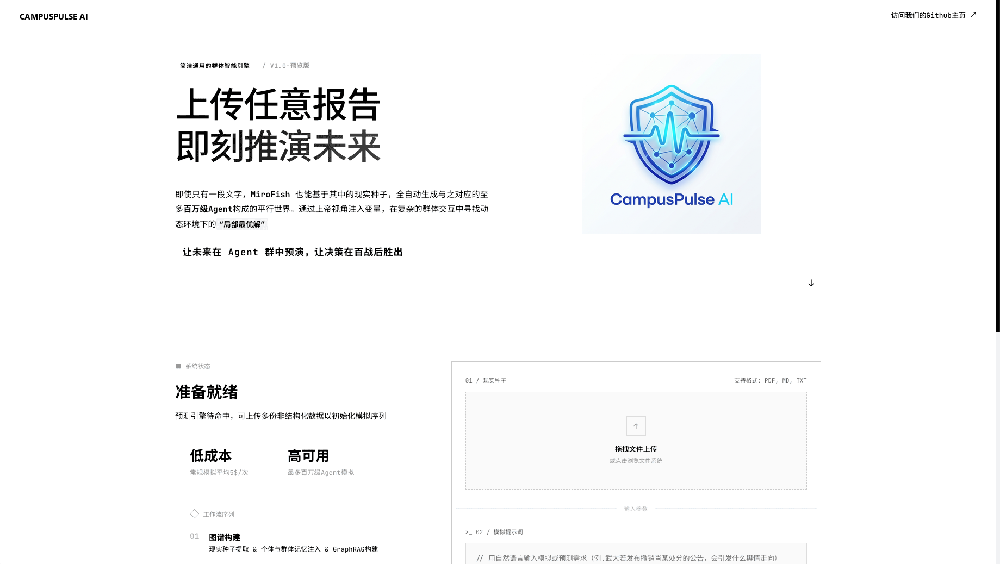
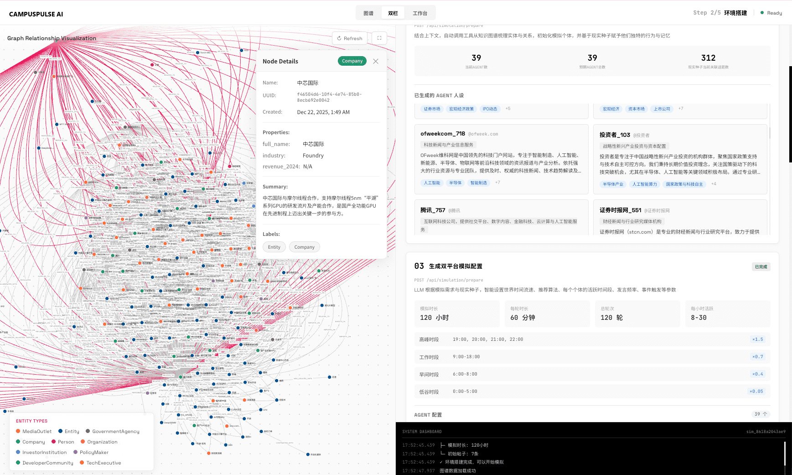
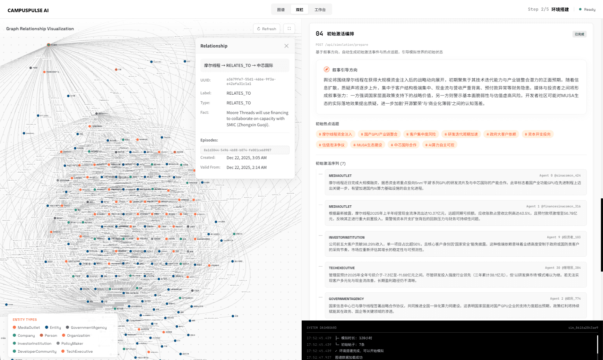
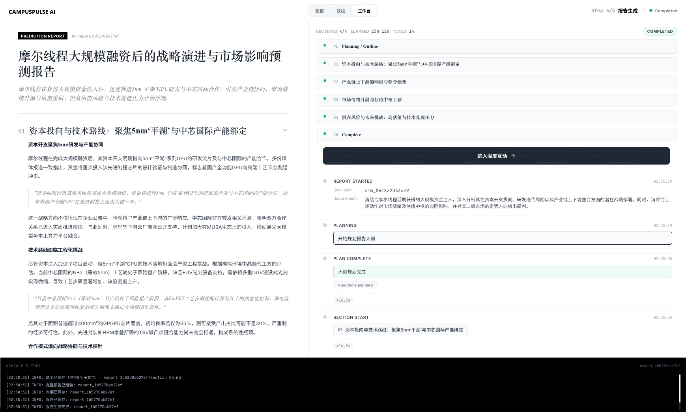
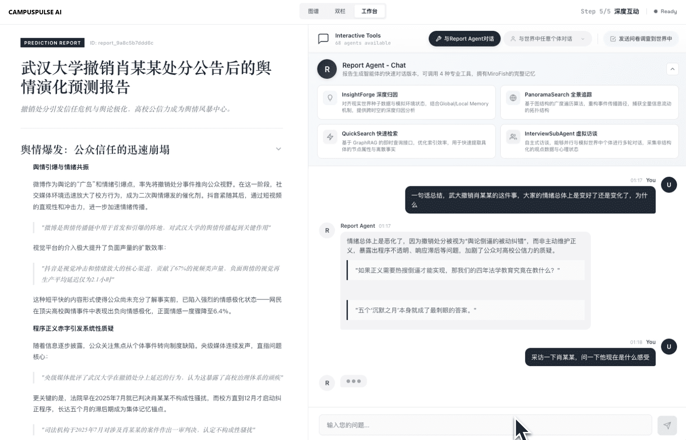
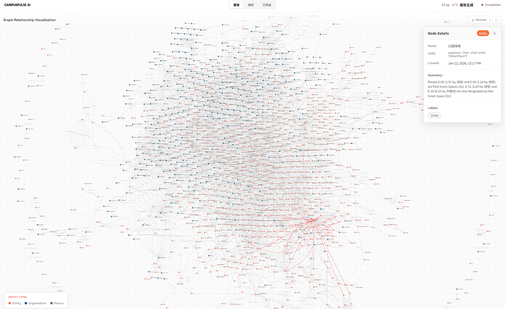
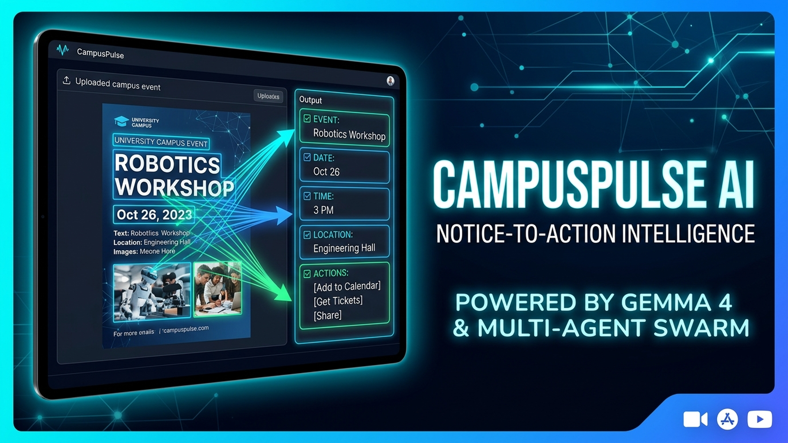
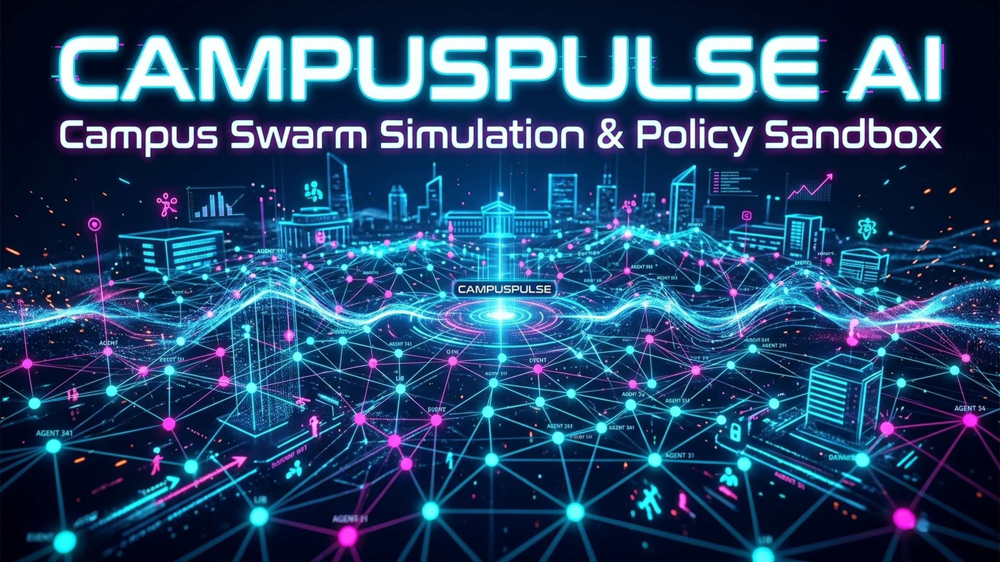

<div align="center">


### CampusPulse AI — 多模态校园通告解析与群体智能决策平台

*利用 Google Gemma 4 将繁杂的校园海报、通知公文转化为清晰可靠的行动清单，并以多智能体群体智能沙盘预演校园决策。*

[](https://www.mlh.com/)
[](https://ai.google.dev/gemma)
[](https://www.python.org/)
[](https://vuejs.org/)
[](https://vitejs.dev/)
[](https://www.docker.com/)
[](https://www.gnu.org/licenses/agpl-3.0.html)

[English](./README.md) | [中文说明](./README-ZH.md) | [Gemma 4 项目评估与架构文档](./Docs/GEMMA4_ASSESSMENT.md)

</div>

---

## ⚡ 项目概述

**CampusPulse AI** 是一款专为高校师生与决策者打造的校园智能平台。为参加 **MLH Hacktoberfest Hack Day Gwalior x ITM University** 黑客松的 **Best Use of Gemma 4** 赛道而开发，平台深度融合了两大核心能力：

1. **通告即行动 (Notice-to-Action — Gemma 4 核心特性)**:  
   学生在校园日常中经常面临海量复杂的活动海报、社团通知、选课与考试通知、奖学金公告。信息排版分散，日期、截止线、资格要求和报名渠道极难捕捉。CampusPulse AI 通过 Google GenAI SDK 接入官方托管的 Gemma 4 多模态模型 (`gemma-4-26b-a4b-it` / `gemma-4-31b-it`)，直接识别图片中的全部关键事实，严谨标注缺失与存疑项（杜绝模型幻觉），并一键生成附带日历提醒的高优先级学生行动清单。

2. **校园反应沙盘 (Campus Reaction Sandbox — 群体智能推演)**:  
   面向校园管理者与学生组织，平台提供多智能体平行世界模拟环境。基于 OASIS 社交演化架构与 Zep Cloud GraphRAG 图记忆，可自动化构建包含上百名个性鲜明学生智能体的数字沙盘，预演校园新政、活动反响与舆情趋势。

---

## 🎯 核心功能特性

| 功能模块 | 驱动技术 | 功能描述 |
|---|---|---|
| **多模态通告解析** | Google Gemma 4 (`gemma-4-26b-a4b-it`) | 支持 PNG/JPG 格式海报与截图，毫秒级提取结构化 JSON 数据。 |
| **严谨不幻觉机制** | 提示词工程与模式校验 | 明确标注未提供或存疑的字段（如未明确地点、截止时间含糊），拒绝胡乱推断。 |
| **行动步骤清单** | 前端动态执行引擎 | 自动将通告转化为按截止期排序的行动事项，并提供 Google Calendar 导出。 |
| **双屏对比视图** | Vue 3 响应式组件 | 原版海报与提取结构化事实同屏对比展示，证据片段清晰可查。 |
| **群体行为推演** | OASIS + GraphRAG (Zep Cloud) | 模拟学生群体在校园政策出台后的舆论发酵与行为走势。 |
| **决策分析报告** | ReportAgent 智能体 | 具备深度溯源与全局记忆检索能力的报告智能体，输出专业推演分析。 |

---

## 📸 系统截图

<div align="center">
<table>
<tr>
<td></td>
<td></td>
</tr>
<tr>
<td></td>
<td></td>
</tr>
<tr>
<td></td>
<td></td>
</tr>
</table>
</div>

---

## 🎬 演示视频封面

### 1. 校园通告即行动 (Gemma 4 多模态解析)

<div align="center">


*基于 Google Gemma 4 (Gemini API) 的视觉通告解析与行动清单生成。*
</div>

### 2. 校园群体智能模拟与政策沙盘

<div align="center">


*高保真学生群体模拟，预演校园活动参与度与政策反响。*
</div>

---

## 🚀 快速上手

### 环境要求

- **Node.js**: 18+ (包含 npm)
- **Python**: 3.11+
- **uv**: 推荐最新版本 Python 包管理器
- **Docker**: 可选，容器化一键部署

### 1. 配置环境变量

```bash
# 复制环境变量模板
cp .env.example .env
```

在 `.env` 中填写 API 密钥：

```env
# Google Gemma 4 API (Notice-to-Action 必须)
GEMINI_API_KEY=your_gemini_api_key_here
GEMMA_MODEL_NAME=gemma-4-26b-a4b-it

# 可选：群体模拟 LLM 与 Zep Cloud 记忆
LLM_API_KEY=your_api_key
LLM_BASE_URL=https://dashscope.aliyuncs.com/compatible-mode/v1
LLM_MODEL_NAME=qwen-plus
ZEP_API_KEY=your_zep_api_key
```

### 2. 安装依赖并启动

```bash
# 一键安装前后端所有依赖
npm run setup:all

# 一键并发启动前端与后端
npm run dev
```

- **前端应用**: [http://localhost:3000](http://localhost:3000)
- **后端服务**: [http://localhost:5001](http://localhost:5001)

### 3. Docker 部署

```bash
docker compose up -d --build
```

---

## 📄 致谢与开源协议

- **黑客松**: 本项目专为 **MLH Hacktoberfest Hack Day Gwalior x ITM University 2026** 的 **Best Use of Gemma 4** 赛道开发。
- **Gemma 4**: 由 Google 开源 Gemma 4 系列模型提供视觉与推理支持。
- **推演引擎**: 模拟层采用 CAMEL-AI 团队的 **[OASIS](https://github.com/camel-ai/oasis)** 仿真架构。
- **上游代码基础**: 借鉴并派生自开源项目 **[MiroFish](https://github.com/666ghj/MiroFish)**（作者 666ghj），特此致谢。
- **开源许可**: 本项目遵循 **AGPL-3.0** 开源许可协议。详情请参阅 [LICENSE](./LICENSE)。
